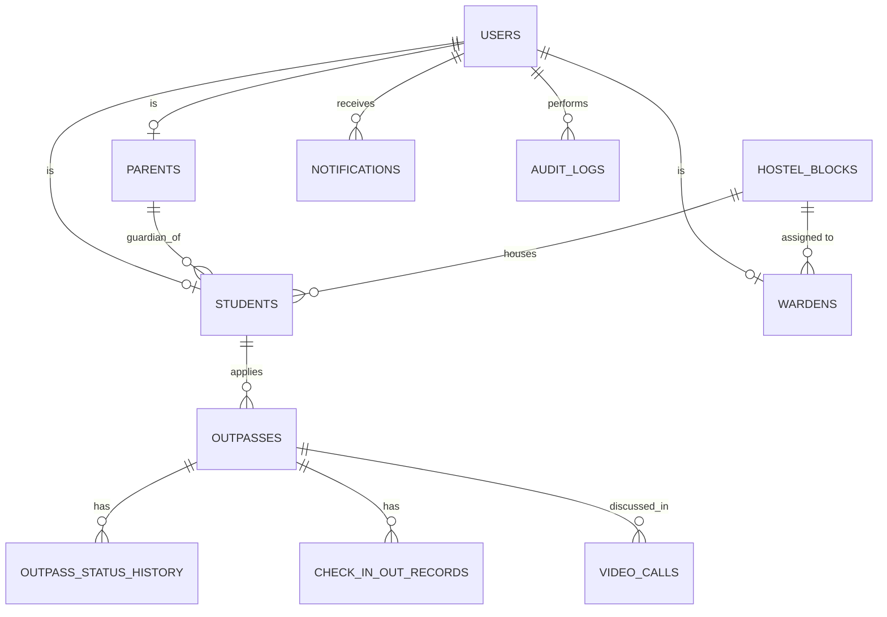

# Smart Hostel Outpass Management System

Digitises hostel outpasses: **student applies → parent approves → block warden approves → check-out / check-in**, with live notifications, an audit trail, automatic overdue detection, parent–warden video calls and an admin panel.

## Stack
React 18 + Vite · Node/Express · MySQL (mysql2, parameterised queries) · JWT + bcrypt · Socket.IO · WebRTC · node-cron · Jest/Supertest.

## Quick start (macOS / VS Code)
```bash
brew install mysql node && brew services start mysql
cd server && cp .env.example .env     # set DB_PASSWORD (empty if root has none) and a long JWT_SECRET
npm install
npm run seed                          # creates DB + tables + synthetic data
npm run dev                           # API → http://localhost:5000
# new terminal
cd client && cp .env.example .env && npm install && npm start   # UI → http://localhost:3000
```
Tests (uses a separate `outpass_test` database):
```bash
cd server && npm run seed:test && npm test
```

## Demo credentials (development only — all data is fictional)
| Role | Email | Password |
|---|---|---|
| Student | student001@example.com | Student@123 |
| Parent | parent001@example.com | Parent@123 |
| Warden | warden001@example.com | Warden@123 |
| Admin | admin@example.com | Admin@123 |

`studentNNN` (001–120) ↔ `parentNNN`. Students 001–060 are girls in G1–G8, 061–120 boys in B1–B12. `wardenNNN` owns blocks in order G1…G8, B1…B12. Change or delete these accounts before any real deployment.

## Workflow
```
PENDING_PARENT_APPROVAL ─parent─▶ PARENT_APPROVED ▶ PENDING_WARDEN_APPROVAL ─warden─▶ WARDEN_APPROVED ▶ APPROVED
        │ reject                                              │ reject                         │
        ▼                                                     ▼                                ▼
  PARENT_REJECTED                                      WARDEN_REJECTED        check-out ▶ ACTIVE ─check-in▶ CHECKED_IN
                                                                                   │ past expected return (cron)
                                                                                   ▼
                                                                                OVERDUE ─check-in▶ CHECKED_IN
APPROVED ─unused past end─▶ EXPIRED;  cancellable while pending or APPROVED
```
Transitions are enforced in `server/src/workflow.js`; anything else returns **409**. Each transition writes `outpass_status_history` and `audit_logs` inside one DB transaction. The warden is never chosen by the student: `outpass → student → block → warden`.

## ER diagram

`users` holds login data for all roles; `students`/`parents`/`wardens` hold role fields (shared primary key = `users.id`). `wardens.block_id` is deliberately **not unique**, so several wardens per block can be supported later (the UI currently shows and uses one). Warden details are never copied into outpasses (3NF).

## API (all JSON, `Authorization: Bearer <token>`; errors → `{success:false,message}`)
| Method & path | Who | Purpose |
|---|---|---|
| POST `/api/auth/login` · GET `/api/auth/me` · POST `/api/auth/logout` | all | session |
| POST `/api/outpasses` | student | apply |
| GET `/api/outpasses?status=&q=` (alias `/my`) | all (role-scoped) | list / search |
| GET `/api/outpasses/:id` | owner, parent, block warden, admin | details + timeline |
| PUT `/api/outpasses/:id/cancel` | student | cancel |
| POST `/:id/parent-approve` · `/parent-reject {reason}` | linked parent | parent decision |
| POST `/:id/warden-approve` · `/warden-reject {reason}` | block warden | warden decision |
| POST `/:id/check-out` · `/check-in {gate,notes}` | student | gate movement |
| GET `/api/warden/dashboard` · `/pending-requests` | warden | analytics / queue |
| GET `/api/notifications` · PUT `/:id/read` | all | history |
| POST `/api/video-calls {outpass_id}` · `/:id/join` · `/:id/decline` · `/:id/end` | warden / parent | video call |
| `/api/admin/*` summary, audit-logs, blocks, students, parents, wardens, `PUT users/:id/status` | admin | management |

## WebRTC
Signaling runs over Socket.IO (`call:join`, `call:signal`); media is peer-to-peer. Works on localhost and simple networks with the default public STUN server. **Restrictive NATs (campus Wi-Fi, mobile data) need a TURN server** (e.g. coturn): set `TURN_URL`, `TURN_USERNAME`, `TURN_CREDENTIAL` in `server/.env`. Browsers require HTTPS (or localhost) for camera access.

## Security notes
bcrypt hashes · JWT (8h, invalid/expired → automatic logout) · role middleware on every route · object-level checks (own student, linked parent, own block) · parameterised SQL · Helmet · CORS limited to `CLIENT_ORIGIN` · login rate limit · secrets only in `.env` · token kept in `sessionStorage`.

## Known gaps / future improvements
- File/document attachments and validated upload storage
- Warden "request more information" step and video-call history screen
- Student profile page and parent "student profile" view
- Admin: password reset, CSV bulk import, hard delete, exports
- Refresh tokens / token revocation on logout; password-change flow
- Email/SMS/push notifications; QR-code gate scanning by security staff (check-in/out is currently student-initiated)
- Multiple wardens per block in the UI; dashboards with date-range charts
- Screenshots: add to `docs/` (placeholders: Login, Student, Parent, Warden, Admin, Video call)
